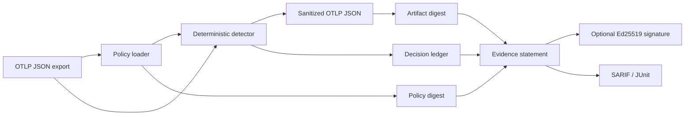

# TraceVeil

> **Compile privacy policy evidence from GenAI telemetry — before it leaves your environment.**

TraceVeil is a local-first, deterministic policy compiler and verifier for **OpenTelemetry JSON exports** containing GenAI spans. It scans configured telemetry fields for a bounded set of secrets and PII patterns, sanitizes matching values in memory, and produces a portable evidence statement that an independent reviewer can verify later.

It is intentionally not another tracing backend, LLM evaluator, or hosted dashboard. TraceVeil sits between the telemetry producer and the exporter: it turns a privacy policy into a reproducible decision record.

## Why TraceVeil exists

GenAI observability is useful precisely because it can contain prompts, completions, tool arguments, tool results, and retrieval context. That same context can contain secrets, credentials, PII, or customer data. Existing OpenTelemetry guidance makes the application responsible for deciding what is sensitive and for configuring filtering appropriately. TraceVeil makes that responsibility explicit, reviewable, and testable.

The central question is not merely *“did we redact a token?”* It is:

> **Can a reviewer verify which policy was applied, which attribute class was changed, and whether the sanitized artifact is the one that policy evaluated — without receiving the raw telemetry?**

## What is implemented in `0.1.0`

| Capability | What it does |
|---|---|
| OTLP JSON traversal | Processes canonical `resourceSpans → scopeSpans → spans → attributes` exports without requiring an SDK or a collector. |
| Deterministic detection | Detects bounded patterns for API credentials, JWTs, private-key headers, bearer tokens, email addresses, and phone numbers. |
| Policy-as-code | Loads a small TOML policy with detector rules, attribute-path globs, actions, guarded-key rules, and `fail-closed`/`report-only` mode. |
| Safe sanitization | Preserves safe content where possible, removes only policy-matched spans of text, handles JSON-encoded GenAI messages, and never mutates the caller’s payload. |
| Evidence capsule | Emits a canonical JSON statement with digests for the input payload, sanitized payload, policy, and emitted file, plus non-sensitive decision metadata. |
| Offline verification | Validates the evidence schema, optional Ed25519 signature, evidence fingerprint, and digest of the sanitized artifact. |
| CI formats | Emits SARIF for code scanning and JUnit XML for CI systems; neither report contains raw matched content. |
| GitHub Action | Ships a composite action that runs the local compiler and uploads SARIF findings. |

## Quick start

TraceVeil requires **Python 3.11+**.

```bash
python -m pip install traceveil

# Create a reviewed policy file.
traceveil init --out traceveil.toml

# Sanitize an OTLP JSON export and write a verifiable evidence capsule.
traceveil sanitize otlp-export.json \
  --policy traceveil.toml \
  --out traceveil.sanitized.json \
  --evidence traceveil.evidence.json \
  --sarif traceveil.sarif \
  --junit traceveil.junit.xml

# Verify integrity later, on another machine if needed.
traceveil verify \
  --evidence traceveil.evidence.json \
  --sanitized traceveil.sanitized.json
```

When working from a clone before packaging is published:

```bash
python -m pip install -e ".[dev]"
pytest
ruff check .
```

## Minimal policy

```toml
[policy]
name = "production-genai"
version = "2026-08-26"
mode = "fail-closed"

[guards]
key_patterns = ["*authorization*", "*token*", "*secret*", "*api*key*"]
action = "redact"

[[rules]]
id = "credentials"
kinds = ["jwt", "github_token", "openai_key", "bearer_token"]
paths = ["gen_ai.*", "http.*", "*"]
action = "redact"
severity = "critical"

[[rules]]
id = "personal-data"
kinds = ["email", "phone"]
paths = ["gen_ai.*", "*"]
action = "redact"
severity = "medium"
```

See [the policy reference](docs/policy.md) for the full contract and its limitations.

## Evidence model

TraceVeil uses canonical JSON serialization and SHA-256 digests. The emitted evidence statement contains the policy digest, raw-input digest, sanitized-payload digest, sanitized-file digest, decision counts, and decision metadata such as path, detector kind, action, and severity. It **does not** include the original matched values.

```text
OTLP JSON ──► policy compiler ──► sanitized OTLP JSON
                    │                    │
                    └──── evidence ──────┘
                           policy + input + output + subject digests
```

For a locally owned signing identity, generate an Ed25519 pair and sign the evidence:

```bash
traceveil keygen --private-key traceveil-private.key --public-key traceveil-public.key

traceveil sanitize otlp-export.json \
  --out traceveil.sanitized.json \
  --evidence traceveil.evidence.json \
  --private-key traceveil-private.key

traceveil verify \
  --evidence traceveil.evidence.json \
  --sanitized traceveil.sanitized.json \
  --public-key traceveil-public.key
```

The private key is local material. Do not commit it, pass it in logs, or use it as a replacement for organizational key management.

## GitHub Actions

```yaml
name: Telemetry privacy gate

on:
  workflow_dispatch:

jobs:
  sanitize:
    runs-on: ubuntu-latest
    permissions:
      security-events: write
      contents: read
    steps:
      - uses: actions/checkout@v4
      - uses: ateeqdesktop-dot/traceveil@v0
        with:
          input: artifacts/otlp-export.json
          policy: traceveil.toml
          out: artifacts/otlp.sanitized.json
          evidence: artifacts/traceveil.evidence.json
          sarif: artifacts/traceveil.sarif
          junit: artifacts/traceveil.junit.xml
```

The action writes artifacts before optional failure behavior. Use `fail-on: critical` only when the pipeline should stop after evidence is compiled.

## Design constraints and non-goals

TraceVeil is deliberately conservative:

| TraceVeil does | TraceVeil does **not** do |
|---|---|
| Apply deterministic, inspectable pattern rules locally | Claim to infer every kind of personal or confidential information |
| Preserve a reviewable policy-to-decision link | Replace legal, privacy, security, or compliance review |
| Verify a specific sanitized artifact and optional local signature | Guarantee that a telemetry producer captured every relevant field |
| Complement OpenTelemetry, SLSA, and existing observability platforms | Replace collectors, trace stores, model evaluators, or secret managers |

Regex and key-name rules are a bounded control, not a universal privacy classifier. Use application-specific rules, data minimization, least-privilege telemetry settings, and a secure retention policy. See [Security](SECURITY.md) and [architecture](docs/architecture.md).

## Architecture

TraceVeil is a small package with strict trust boundaries. The raw input is loaded and transformed in the local process; exported artifacts contain only sanitized data and metadata required to validate the result.



More detail: [architecture](docs/architecture.md), [threat model](docs/security.md), and [competitive research](docs/research.md).

## Development

```bash
python -m pip install -e ".[dev]"
pytest
ruff check .

# Full example, including artifacts in /tmp.
traceveil sanitize tests/fixtures/agent-trace.json \
  --out /tmp/traceveil.sanitized.json \
  --evidence /tmp/traceveil.evidence.json \
  --sarif /tmp/traceveil.sarif \
  --junit /tmp/traceveil.junit.xml
traceveil verify --evidence /tmp/traceveil.evidence.json --sanitized /tmp/traceveil.sanitized.json
```

Please read [CONTRIBUTING.md](CONTRIBUTING.md) before opening an issue or pull request. Security reports belong in [SECURITY.md](SECURITY.md), not public issues.

## Roadmap

`0.2` will prioritize policy test fixtures, an OTLP Collector processor, richer OpenTelemetry GenAI attribute support, and optional DSSE/Sigstore interoperability. `1.0` requires a stable policy schema, versioned compatibility guarantees, and external review of the threat model. See [ROADMAP.md](ROADMAP.md).

## License

MIT. See [LICENSE](LICENSE).

