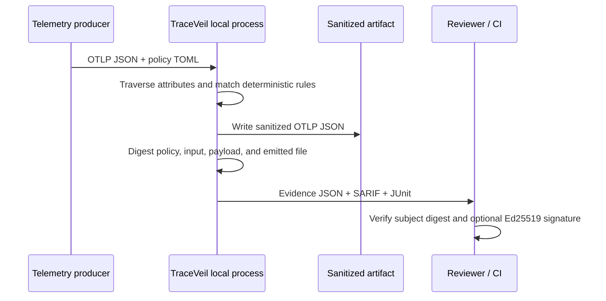

# Architecture

TraceVeil is designed as a **verification compiler**, not a telemetry platform. It consumes a finite artifact, applies a known policy deterministically, produces a different finite artifact, and emits the metadata required to verify that relationship later.

## Product boundary

The system accepts canonical OpenTelemetry JSON exports containing `resourceSpans`, `scopeSpans`, `spans`, and `attributes`. This constraint is intentional. A deterministic file boundary makes review, fixture testing, offline execution, digesting, and CI outputs straightforward.

## Components

| Component | Responsibility | Trust boundary |
|---|---|---|
| `policy.py` | Parses and validates TOML; resolves guarded-key and detector rules. | A policy is configuration, not a secret. Its digest binds decisions to a reviewed version. |
| `detectors.py` | Executes bounded regex detectors locally. | Never sends content to an external service or model. |
| `otlp.py` | Traverses OTLP JSON and preserves `AnyValue` shape. | Rejects malformed top-level documents instead of guessing. |
| `sanitizer.py` | Applies the selected rule, makes replacements, and records non-sensitive decisions. | Raw values exist only while the local process is executing. |
| `evidence.py` | Canonicalizes, hashes, signs, and verifies the privacy statement. | The statement refers to digests and decision metadata, never raw values. |
| `reports.py` | Produces SARIF and JUnit for CI. | Findings use paths and rule metadata; raw content is not serialized. |
| `cli.py` | Creates a stable human and automation interface. | CLI does not open sockets, read environment secrets, or upload artifacts. |

## Data flow

The raw OTLP input digest is calculated over its canonical JSON representation, not its on-disk whitespace. The output digest is calculated the same way, while the evidence subject digest is calculated over the emitted sanitized file bytes. This gives three distinct checks:

| Digest | Purpose |
|---|---|
| `predicate.input.sha256` | Identifies the logical source payload evaluated by the compiler. |
| `predicate.sanitized_payload.sha256` | Identifies the logical JSON payload created in memory. |
| `subject.digest.sha256` | Binds the evidence to exactly one output file that can be verified later. |

The policy digest is SHA-256 of normalized policy fields and rules. A reviewer can recompute it from the reviewed policy document and distinguish a policy change from an execution change.

## Error behavior

TraceVeil rejects an invalid top-level OTLP shape or invalid policy rather than continuing with an ambiguous interpretation. This is its fail-closed behavior at configuration and structure boundaries. A policy finding, by contrast, is normally a **successful sanitization decision**: the output is safe to export and the evidence preserves the fact that the change occurred. Pipelines can opt into a non-zero post-artifact exit with `--fail-on`.

## Extensibility points

The MVP keeps extension points narrow. Future work can add policy schema versions, collector adapters, detector plugins, DSSE envelopes, and OS key-store integrations without changing the core evidence contract. Any extension must preserve three properties: deterministic input-to-output behavior, non-disclosure of raw matched values, and independently checkable artifact binding.

